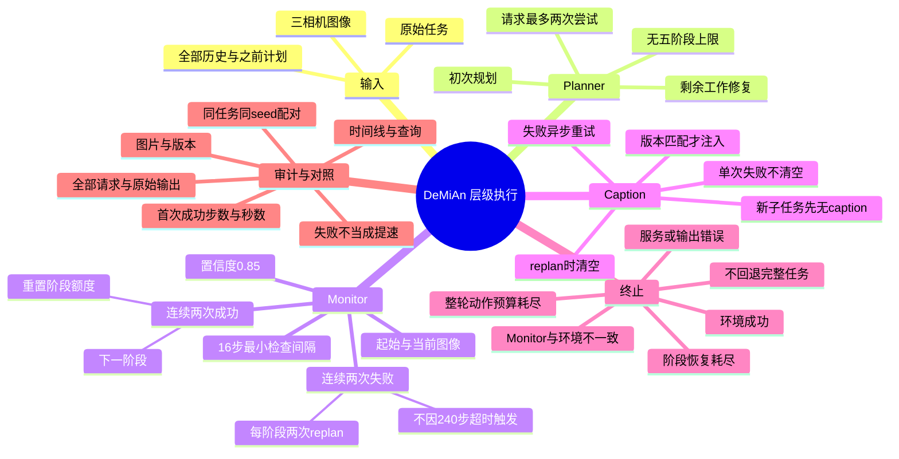

# DeMiAn 层级执行：完整逻辑与实验记录（2026-11-03）

本文描述本次修改后的代码行为。它取代 2026-11-02 恢复方案中的全任务 fallback 和阶段 240 步超时策略。
用户已确认：不新增未披露的超时、失败条件、重规划预算或回退机制。
本轮只修改本地代码并提交；未部署 RunAI、未下载权重、未验证成功率提升。

## 1. 文件职责和输入输出

- `hierarchical_controller.py`：计划、视觉验证、caption 的异步请求，阶段状态、恢复预算、终止原因。
- `qwen_hierarchy_server.py`：通用视觉语言模型的 `/plan`、`/verify` 服务；结构校验、原始输出、服务时序。
- `run_robocasa_eval.py`：真实环境与策略动作循环；环境成功为最终成功依据；统一计时、结果存储。
- `hierarchy_trace.py`：事件即时追加、图像分离存储和可读时间线。
- `hierarchy_report.py`：事件查询和原 DeMiAn / hierarchy 配对耗时比较。
- 两个 `test_hierarch*.py`：不加载模型或模拟器的控制逻辑、真实评估函数及 HTTP 服务测试。
- 现有 `qwen_instructor_server.py`：caption 模型服务，未修改其模型或生成设置。

`hierarchy_url` 未配置时保持原评估控制路径；只新增统一计时、episode 身份及逐 episode 结果文件。
配置 hierarchy 后禁止同时使用旧的 GT subgoal plan 或逐帧 GT caption 来控制阶段；层级控制器独占 caption。
原始总任务仍传给 Planner/Monitor；π0.5 在计划生效后接收当前子任务及其匹配 caption。

## 2. 初始规划与重规划

初始 Planner 尚未返回时：原始任务＋无 caption，动作继续；不是失败后的 fallback。
Planner 得到当前三个视角、原始任务、全部完成/恢复历史、反馈、之前的计划和当前阶段编号。
提示词要求仅规划剩余工作、保持依赖顺序、不发明物体或能力。
计划各阶段包含 skill、instruction、success_criteria、caption_type、caption。
计划保留完整列表，没有最多五阶段限制。解析失败不截断执行。
无法可靠规划时返回 unplannable 和原因；按模型输出错误处理，允许一次重试。

重规划：保持当前子任务，立即清空旧 caption；请求在后台执行。
新计划安装：切换至修复计划第一子任务，保留已经消耗的阶段重规划次数。
每份新计划与每次进入阶段都更新 generation；旧版本结果不能生效。
历史保存已完成事项与未确认事项，但不会用硬编码任务表保证模型绝不重复动作；重复规划仍需实验检查。

## 3. Monitor 的依据和判定

输入为阶段起始三个视角＋当前三个视角，原始任务、当前阶段及其 success_criteria、步数。
不是连续视频；不读取模拟器内部状态。caption 不能作为成功证据。
要求区分靠近/抓住、悬在容器上方/放入并释放、接近按钮/已经启动。
遮挡或视觉不可知用 uncertain；未完成动作不等于 failure。
failure 用于可见必要条件丢失或计划需要恢复；它仍是模型推断，不是物理真值。

返回 status（ongoing/success/failure/uncertain）、confidence、evidence。
置信度默认 0.85，是未经校准的模型自报评分。
成功与失败分别要求连续两次有效高置信度判断；同一次请求不可重复计数。
相反状态、ongoing、uncertain、低置信度会重置相应计数。
请求异常打断连续性，即使同一逻辑请求的第二次尝试成功，前一次连续计数也清零。
旧版本请求结果不参与计数。

检查最小间隔 16 个仿真步，阶段开始至少 16 步后检查；只在 action chunk 边界提交。
默认 open_loop_horizon=8，最快约两个 chunk 检查一次。未返回时不堆积同类 Monitor 请求。
异步响应可能使实际检查间隔更长；16 步不是墙钟时间，也不是保证完成一次判断的周期。
确认推进和重规划在 chunk 边界应用；切换时刷新动作缓存，避免继续执行上一子任务动作。

删除两处 240 步未确认完成就重规划的路径：没有新增软/硬阶段超时。
持续 ongoing/uncertain 可以用完整轮动作预算；这是本次明确选择，不暗中增加停滞检测。

## 4. 阶段预算与终止

每阶段默认两次重规划，初始规划不计数。
第一次确认失败→修复1；再次确认失败→修复2；修复2之后再次确认失败→终止。
成功确认并进入下一子任务才清零，即使下一子任务来自修复计划。
仅安装修复计划、重新编号、请求重试不清零。另记 total_replans，不设额外全局重规划次数上限。

终止原因：

| 原因 | 解释 |
|---|---|
| environment_success | 模拟器 success 为真，成功结束 |
| max_steps_exhausted | 整轮动作上限耗尽，未成功 |
| environment_terminated | 环境终止或被截断，未成功 |
| stage_replan_budget_exhausted | 当前阶段两次修复后，再次连续确认失败 |
| monitor_environment_disagreement | 最后阶段被确认完成，但环境仍未报告成功 |
| service_error | Planner/Monitor 一次重试后仍有通信或服务异常 |
| model_output_error | 一次重试后计划/判断仍无法通过输出校验 |

没有完整任务＋无 caption 的错误回退。服务错误与模型判失败分开统计；失败 episode 不删除。
环境成功检查先于 Monitor 状态转移，避免已经成功的 episode 被误记为判定不一致。
环境真值只用于评估/成功结束，不用于触发额外规划。
判定不一致当前直接失败，代码注释标明未来可研究诊断/恢复，但本轮不启用。
整轮上限由 --max-steps 决定：此前 composite 实验使用 1200；脚本通用默认仍是 400，不偷偷改成 1200。

## 5. Caption 生命周期

Instructor 模式下每个新阶段请求 caption；成功后保持该 caption，不自动周期刷新。
单次 Monitor failure 不清空。两次有效 failure 真正触发 replan 才清空，并作废旧请求。
重规划等待期间为当前子任务＋无 caption；安装后为新子任务＋无 caption。
只有匹配当前版本的返回才能在 chunk 边界生效。
caption 空文本、非法文本、服务或网络错误均记录，并用最新图像、当前子任务重试。
重试在后续可用 chunk 边界发起，同时最多一个当前有效请求；没有次数上限、没有额外时间阈值。
成功得到有效 caption 后停止重试；新阶段、重规划或 episode 结束时停止旧请求的重试。
已开始的底层 GPU/HTTP 调用不能保证立即停止，但其返回不得注入新阶段。
caption_mode=planner 使用 Planner 提供的 caption；none 始终无 caption，供消融使用。

## 6. 请求重试、排队、限制和错误

Planner/Monitor 每次逻辑请求初次＋一次重试；服务端不再另外自动重试，避免叠加成四次。
错误反馈随第二次尝试发送。网络超时保留请求身份，服务返回最近完成的相同请求，避免重复 GPU 推理。
格式错误使用新的尝试身份，可以真正重新生成；全部尝试原始输出均保留。
HTTP 默认 timeout=60 秒：通信等待参数，不是机器人执行失败阈值，也不保证整个请求严格在 60 秒完成。
服务记录接收、开始推理、排队、推理时间。客户端记录请求等待、错误类型、HTTP 状态和错误正文。
仅客户端超时而没有服务端证据时，原因明确写未确认，不能推测成 OOM。

HTTP 接收改为多线程，模型生成仍由一把锁串行执行，避免未经验证的并发 GPU 内存需求。
根据 session/generation 拒绝已知旧版本；根据客户端请求有效期丢弃排队过期请求。
客户端取消尚未开始的工作；已经开始的计算不强行中断。多线程不等于推理能力翻倍。
每个 session/operation 只缓存最近一个完成请求用于去重；服务面向单个评估工作流，不是多租户平台。

保留并披露的边界：
- Planner/Monitor max_new_tokens 默认 1024，do_sample=False，use_cache=True，enable_thinking=False。
- 模型输出不是无限长；被截断的 JSON 作为输出错误重试，不把前半份计划拿来执行。
- instruction 最长 300 字符；success_criteria/evidence 最长 600；skill 最长 160。
- Planner caption 最长 400；Instructor caption 最长 1200；空 Instructor caption 作为无效输出重试。
- 服务请求体最多 8,000,000 字节，plan 要求三个当前图像，verify 要求另加三个起始图像。
- 可选 skills 列表非空时必须匹配其中的 skill；caption_type 为现有五类之一。
- 原 Instructor 服务 max_new_tokens 默认128、bfloat16、默认 cuda:1；具体部署以启动命令为准。
- hierarchy 服务默认 cuda:0、127.0.0.1:8002；模型权重路径由 --model-path 明确指定，不由代码选择 Qwen 权重版本。

## 7. 图像与可追溯日志

使用现有 openpi_client.image_tools.resize_with_pad 对齐普通 Instructor：256×256、双线性、黑色补边，JPEG quality=90。
默认环境相机本来就是256×256，不额外缩小。记录源图像尺寸和发送编码方式。
每阶段保存起始画面；每次请求关联当时画面。图片按内容哈希去重存储，文字日志保留相对路径。
保留全部模型接口可见输出，不声称取得模型未公开的内部思维链。

输出：
- 结果根目录 args.json、run_metadata.json（提交号、跟踪文件是否修改、主机、Python）。
- 每任务 episode_NNNN.json：每个 episode 完成立即保存，避免等待整组任务结束。
- 每个 hierarchy episode 的 episode_NNNN_hierarchy/events.jsonl、timeline.md、images/。
- 服务 --trace-dir 下同样有 events.jsonl、timeline.md、images/，保存客户端超时后服务完成的原始结果。
- 事件包含请求身份、版本、尝试次数、输入、输出、证据、计数、采用/丢弃/终止原因与时间。
- 没有 episode_end 的日志只表明非正常中断，具体原因未知；不猜测删除/抢占/OOM。
- 已运行后台请求可能在 episode_end 后追加迟到结果；不会改变环境成功和终止原因。
- 日志每次追加关闭文件，进程退出前已写入的事件仍可查询；不保证机器断电级持久性。

查询示例（在仓库根目录）：

```bash
python openpi/scripts/eval/hierarchy_report.py query /path/to/events.jsonl --operation plan
python openpi/scripts/eval/hierarchy_report.py query /path/to/events.jsonl --event verdict_applied
python openpi/scripts/eval/hierarchy_report.py query /path/to/events.jsonl --request-id REQUEST_ID
```

## 8. 成功耗时与原 DeMiAn 对照

两条执行路径都从 episode 函数内、env.reset 之前开始计时；包含 reset、初始规划/caption 等待与实际执行。
不包含模型加载、环境创建、视频最终编码；这些属于运行准备或输出成本，不混入成功时间。
success_wall_seconds：首次环境成功时的墙钟秒数；success_step：首次成功时仿真步数。
episode_wall_seconds：到结束的实际耗时；失败成功时间为空，不把提前退出当作更快成功。
正常路径与预定动态指令路径均记录相同计时协议。

```bash
python openpi/scripts/eval/hierarchy_report.py compare ORIGINAL/results_shard0.json NEW/results_shard0.json > latency_comparison.json
```

compare 也可接收结果根目录，读取逐 episode 文件，因此中断任务已有结果也可比较。
按 task/episode/seed 配对；重复身份报错。只有双方成功、计时协议相同、max_steps 相同且有时间记录时比较耗时。
报告配对成功数、每对差值和比率、平均/中位新增秒数；失败及原因仍列出。
旧日志缺 seed/计时则不能精确配对，不猜数字。硬件、模型权重、负载、环境条件仍须实验者确认一致。
完整日志的图像编码与写盘成本也包含在新方案运行耗时中；这反映实际部署成本，但不是纯算法推理差异。
服务耗时可能互相重叠，不能把其总和当作 episode 增加的延迟。
代码提供记录和比较工具，尚无此次修改后的真实成功率或时延结论。

## 9. 脑图



## 10. 验证与部署注意

CPU 回归命令：

```bash
CUDA_VISIBLE_DEVICES='' python3 -m unittest discover -s openpi/scripts/eval -p 'test_hierarch*.py'
```

已运行 51 项测试通过，Python 编译和差异空白检查通过；审查详情见 HIERARCHY_REVIEW_20261103.md。
HTTP 集成测试需允许本机临时端口；不连接外部服务。
旧启动命令里的 --hierarchy-phase-timeout、--hierarchy-max-phases 和服务 --max-phases 应删除；不静默接受失效参数。
不要直接把这次改动的结果与不同预算/硬件旧结果归因比较。先确认服务与客户端同一提交版本。
